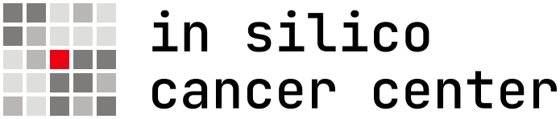

<div align="left">
  
  
</div>
<p></p>

[](https://pypi.org/project/insilico-cancer-center/)
[](https://github.com/pedrofale/iscc/actions/workflows/main.yaml)
[](https://pedrofale.github.io/iscc/)

`iscc` (in silico cancer center) is a Python package that simulates a growing tumor and the
molecular data measured from it. It grows a tumor under copy-number and driver selection in a field
of glands, stroma and an optional metastatic site, where selection depends on the niche. It then
carries the same cells through biopsy and dissociation into bulk and single-cell DNA, RNA and spatial
transcriptomics data, down to sequencing reads, and therapies can be applied during growth. `iscc`
records the ground truth of every cell, clone and niche, and of where and when each clone arose, so
that methods that profile tumor heterogeneity, including those that integrate several data layers,
can be scored against it.

## Main features

- **Selection that depends on the niche.** A lesion founded in a gland stays there until a clone
  carries the breach trait, resident stromal cells add a death hazard that a stromal-survival trait
  offsets, and a metastatic site is entered through a vessel, with a host hazard that a third trait
  offsets.
- **One tumor, many modalities.** DNA, RNA and spatial data come from the same cells, so the
  relationships between data layers follow from one generative process.
- **Ground truth for benchmarking.** The ground truth contains the clone, lineage, genotype, copy
  number, niche and program activity of every cell, and the place and time at which every clone
  arose.
- **Biases fitted to real data.** The technical parameters of each assay can be estimated from a real
  reference dataset. Some defaults were fitted to public reference data, and the others are set by
  hand.

## The pipeline

`iscc` is a pipeline with a command-line tool for each of its main steps:

| Stage | CLI | Does |
|---|---|---|
| Grow | `isccsim` | grow (and treat) a tumor; write ground-truth genotypes / CNVs / expression / spatial state |
| Sample | `isccsample` | biopsy / dissociate the tumor into a sample of cells |
| Assay | `isccdata` | generate bulk & single-cell DNA, RNA, and spatial-transcriptomics data |
| Visualize | `isccfig`, `isccgif` | Muller plot, 2D slice, clone tree, and growth animations |

## Quickstart

```bash
isccsim --sim-config notebooks/example_config.yaml --steps 320 --random-seed 2 -o sim_out
```

`notebooks/example_config.yaml` configures the tumor of the tutorials, a ductal field grown by
tau-leaping. It keeps the package default driver effect of 1.1, at which almost every cell reaches the
maximum division rate during the in-situ phase, so competition between clones is nearly neutral
afterwards. The settings of the paper are in `validation/paper/regime.py`. After growth,
`tumor.diagnose()` flags degenerate tumors, such as extinct, monoclonal or well-mixed ones, and names
the parameter to change.

## Reproducing the landing animation

On the home page we show one simulated tumor carried through a clinical arc on a field of 96 by 96
demes. The lesion fills the ducts (DCIS), invades the stroma after a breach of the duct wall (IDC) and
seeds a metastasis. We then resect the primary and give chemotherapy, under which the metastasis shrinks
to about a quarter of its size and then regrows from a resistant subclone. It is reproducible from the
ordinary `iscc` CLI with the provided config file:

```bash
# 1. run the whole clinical arc (grow -> resect the primary -> chemo -> relapse) and write the
#    compartment trajectory the renderer consumes. --no-tables writes ONLY that trajectory, which
#    is all the renderer reads; drop it if you also want to run isccsample / isccdata on the result.
isccsim --sim-config configs/landing_hero.yaml -o out --no-tables

# 2. fully-labelled version (use --splash to drop the annotations as in the home page).
#    --skip-confinement starts the animation where the lesion first breaks out of its founding duct:
#    the founder is sealed in one acinus for the first ~89% of the run, so without it most frames
#    show a duct where nothing moves.
isccgif out --compartment --skip-confinement -o landing_full.gif
```

`configs/landing_hero.yaml` holds the exact parameters (genome, selection, ductal-field, metastasis and
treatment settings) and the timed treatment `schedule:` (the multi-phase arc, including the surgical
resection). It is `configs/landing.yaml`, the tutorial tumor with a metastasis compartment and
treatment, at the sweep scale of the paper and with a shorter and slightly weaker course of
chemotherapy, and its header lists every changed value. Clones are coloured by their dominant
selective trait and have the same colour in the grids and the Muller plots:

| Colour | Trait |
|---|---|
| blue | proliferation |
| orange | duct escape |
| green | stromal survival |
| purple | metastasis establishment |
| red | chemotherapy resistance |

## Citing iscc

If you use `iscc`, please cite the preprint that describes it and the release you used. The preprint
is in preparation, and release v0.4.0 will be archived with a DOI. Both references will be listed here
when they are available. Until then, the citation of the software is in `CITATION.cff` in the
repository.
